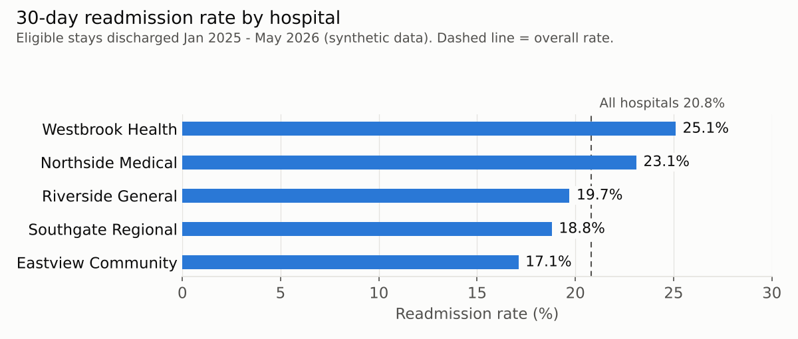
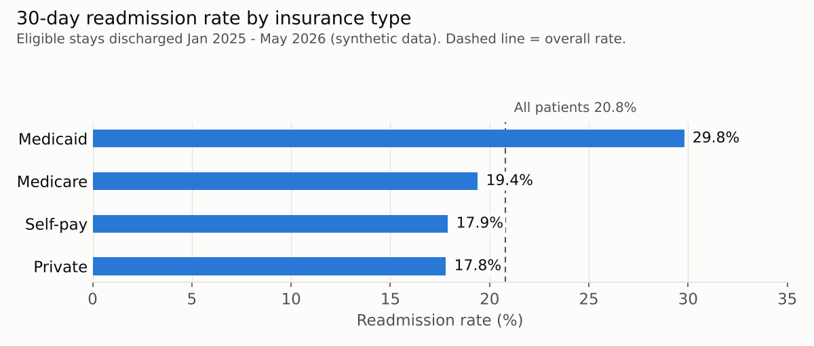
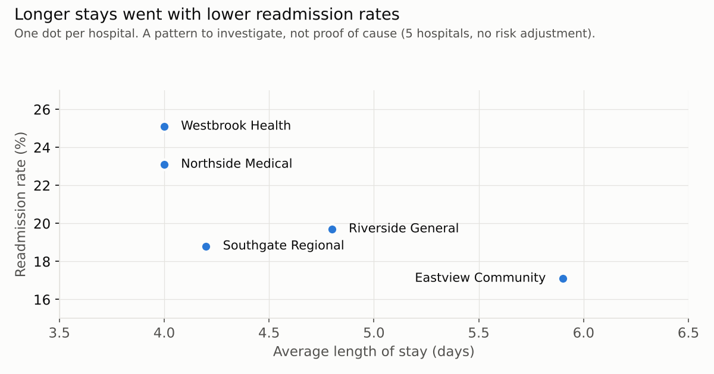

# Hospital Readmissions and Length of Stay (SQL Project)

**Author:** Festus Segun Ajiboye
**Tools:** PostgreSQL, DBeaver
**Data:** Synthetic (computer-generated) data for 5 Indiana hospitals, 2,000 patients and 4,980 admissions. No real patient information is used.

**Status:** Analysis complete. Findings brief coming next.

---

## Project question

How do 30-day readmission rates and length of stay differ across five hospitals and across insurance types?

## Files in this repository

| File | What it does |
|---|---|
| `day10_project_setup.sql` | Builds the project database (hospitals, patients, admissions) |
| `project_audit.sql` | Data-quality audit: 7 checks, findings and decisions |
| `project_analysis.sql` | Clean view and the queries that answer the three project questions |
| `README.md` | This page: overview, measure specification and results |
| `*.png` | Charts of the results |

## How to run it

1. Run `day10_project_setup.sql` in PostgreSQL to build the database.
2. Run `project_audit.sql` to see the data-quality problems.
3. Run `project_analysis.sql` to build the clean view and produce the results below.

---

## Data-quality audit (summary)

| Problem | Found | Decision |
|---|---|---|
| Duplicate stays | 5 extra rows | Kept one copy of each |
| Orphan stays (patient not on file) | 3 | Excluded and reported |
| Unknown hospital ID | 2 | Excluded and reported |
| Missing discharge date | 8 | Excluded and reported |
| Discharged before admitted | 4 | Excluded and reported |
| Missing patient age | 3 patients (7 stays) | Excluded and reported |
| Inconsistent insurance labels | 5 patients | Fixed with `upper(trim())` |

Rule used: fix a value only when the correct value is obvious; otherwise exclude and report. Values are never guessed.

Result: **4,951 clean stays** (from 4,980 raw).

---

## Results

**Overall 30-day readmission rate:** 956 of 4,591 eligible stays (**20.8%**).

### 1. Readmission rate by hospital

| Hospital | Eligible stays | Readmitted | Rate |
|---|---|---|---|
| Westbrook Health | 943 | 237 | 25.1% |
| Northside Medical | 918 | 212 | 23.1% |
| Riverside General | 1,180 | 232 | 19.7% |
| Southgate Regional | 618 | 116 | 18.8% |
| Eastview Community | 932 | 159 | 17.1% |

### 2. Readmission rate by insurance type

| Insurance | Eligible stays | Readmitted | Rate |
|---|---|---|---|
| Medicaid | 944 | 281 | 29.8% |
| Medicare | 1,549 | 301 | 19.4% |
| Self-pay | 262 | 47 | 17.9% |
| Private | 1,836 | 327 | 17.8% |

### 3. Length of stay by hospital

| Hospital | Stays | Average LOS (days) | Median LOS (days) |
|---|---|---|---|
| Eastview Community | 990 | 5.9 | 6 |
| Riverside General | 1,336 | 4.8 | 4 |
| Southgate Regional | 650 | 4.2 | 4 |
| Northside Medical | 983 | 4.0 | 4 |
| Westbrook Health | 992 | 4.0 | 4 |

### Length of stay and readmission together

### Key observations

- Medicaid patients had the highest readmission rate: 281 of 944 eligible stays (29.8%), compared with 20.8% for all patients. The data does not show why; the next step is to compare their length of stay, age and which hospitals they use.
- Hospitals with longer average stays had lower readmission rates (Eastview: 5.9 days, 17.1%; Westbrook: 4.0 days, 25.1%). With only five hospitals and no adjustment for patient mix, this is a pattern to investigate, not proof that longer stays prevent readmissions.

---

## Measure specification: 30-day readmission rate

**1. Unit of analysis:** One hospital stay (an "index stay").

**2. Measurement period:** Stays discharged January 1, 2025 to May 31, 2026. The period stops at May 31 because a stay discharged in June would not have a full 30 days of follow-up data before the data ends on June 30, 2026.

**3. Denominator (who is counted):** Stays for patients aged 18 or older who did not die in hospital, transfer to another acute-care hospital, or leave against medical advice (AMA).

**4. Numerator (who had the event):** Denominator stays followed by an unplanned admission for the same patient 1 to 30 days after discharge.

**5. Exclusions and reasons**

| Exclusion | Reason |
|---|---|
| Died | The patient cannot be readmitted. |
| Transferred to another acute hospital | Care continued at another hospital, so the stay is not a true discharge. |
| Left against medical advice (AMA) | The hospital did not control the discharge. |
| Under 18 | Children's care is measured separately from adults. |
| Planned readmissions | Scheduled care (for example, chemotherapy or surgery) is part of the care plan, not a failure. |

**6. Questions this project answers**
1. Which hospital has the highest 30-day readmission rate?
2. Does the readmission rate differ by insurance type?
3. Which hospital has the longest average length of stay?

**Rate formula:** readmission rate = numerator / denominator x 100

## Limitations

- Synthetic data: the patterns demonstrate the method, not real hospital performance.
- Readmissions are counted only within these five hospitals; returns to other hospitals are not visible.
- Rates are not adjusted for patient age, illness severity or other differences between hospitals.
