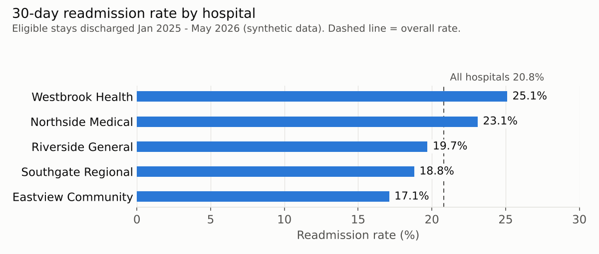

# Findings Brief: 30-Day Readmissions Across Five Hospitals

**Prepared by:** Festus Segun Ajiboye
**Date:** November 2026
**Data:** Synthetic data for 5 Indiana hospitals (2,000 patients, 4,980 admissions). Stays discharged January 2025 – May 2026.

---

## Summary

Across five hospitals, **956 of 4,591 eligible stays (20.8%)** were followed by an unplanned readmission within 30 days. Rates ranged from **17.1% to 25.1%** by hospital, and Medicaid patients stood out with the highest rate.

## Key findings

1. **Hospitals differ.** Westbrook Health had the highest rate (237 of 943 stays, 25.1%) and Eastview Community the lowest (159 of 932, 17.1%). Northside Medical was also above average (212 of 918, 23.1%).

2. **Medicaid patients had the highest rate.** 281 of 944 Medicaid stays (29.8%) were followed by a readmission, compared with 20.8% overall. Private (17.8%), Self-pay (17.9%) and Medicare (19.4%) were close to or below the overall rate. The data does not show why.

3. **Longer stays went with lower readmission rates.** Eastview had the longest average stay (5.9 days) and the lowest rate; Westbrook and Northside had the shortest stays (4.0 days) and the highest rates. With only five hospitals and no adjustment for patient mix, this is a pattern to investigate, not proof that longer stays prevent readmissions.

## Recommendations

1. **Review discharge planning** at Westbrook and Northside, the hospitals with the highest rates and shortest stays, and compare it with Eastview's approach.
2. **Verify that discharges and readmissions are recorded consistently** across all five hospitals before comparing their rates.
3. **Compare discharge-day operations** (staffing, discharge timing, follow-up scheduling) at Westbrook and Northside with Eastview.
4. **Pilot follow-up support for Medicaid patients after discharge**, such as a phone call or appointment within 7 days, and track whether their readmission rate falls.

## Data quality and limitations

- 29 of 4,980 records (0.6%) were excluded after a data-quality audit (duplicates, missing or impossible dates, unknown patients or hospitals, missing age). Values were never guessed.
- Readmissions to hospitals outside these five are not visible.
- Rates are not adjusted for patient age, illness severity or other differences between hospitals.
- The data is synthetic: the results demonstrate the method, not real hospital performance.

*Method and queries: see project_audit.sql and project_analysis.sql in this repository.*
